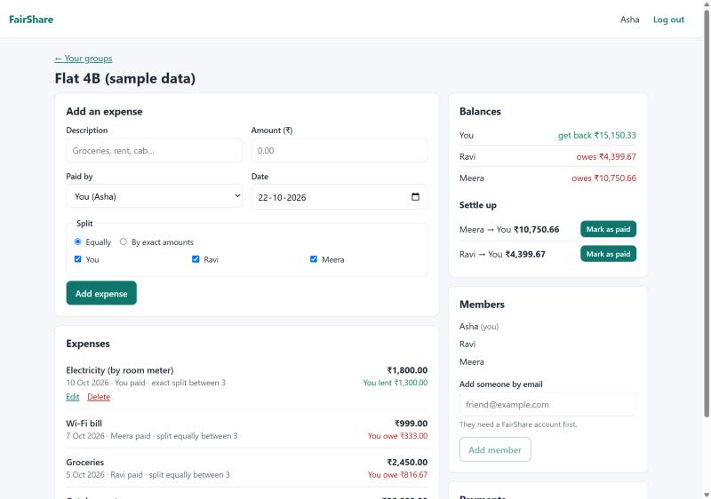
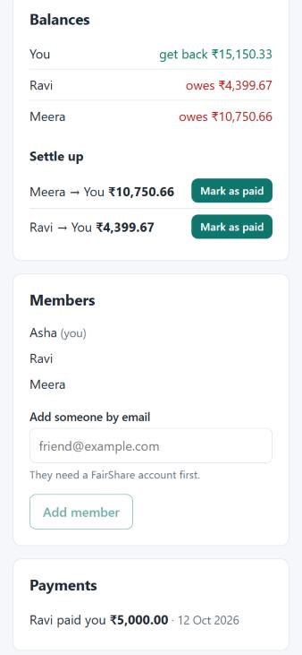

# FairShare

[](https://github.com/manishguptha188/fairshare/actions/workflows/ci.yml)

Split shared expenses with flatmates and friends, then settle up with as few payments as possible.

Sharing a flat or a trip means a stream of small payments: one person pays the rent, another the groceries, someone
else the Wi-Fi. FairShare keeps one shared record per group, works out who owes whom, and suggests the payments that
clear every debt.

Built with **MongoDB, Express, React and Node.js** (the MERN stack).





*Screenshots use the sample data from `npm run seed`; the people and amounts are made up.*

## What it does

- **Accounts:** sign up and log in. Passwords are hashed with bcrypt, and the session is an httpOnly cookie.
- **Groups:** create a group and add people who have an account, by email. Only members can see a group.
- **Expenses:** record who paid and split it **equally** (any subset of members) or by **exact amounts**. The person
  who added an expense can edit or delete it.
- **Balances:** see who gets money back and who owes, worked out from every expense and payment.
- **Settle up:** get a short list of suggested payments (never more than one fewer than the number of people) and
  mark them as paid when the money changes hands.

## What makes it interesting to build

- **Money is exact.** Amounts are stored as whole paise, never floating-point rupees. When ₹10 is split three ways,
  the leftover paisa is assigned deterministically (334 + 333 + 333), and a test checks that splits always add up
  for dozens of totals and group sizes.
- **Balances can't drift.** They are computed from the expenses and payments on each request instead of being stored,
  so editing or deleting an expense can never leave a stale total behind.
- **Authorization is checked in the query.** Every group route only finds groups the user belongs to, and outsiders
  get a 404 that doesn't reveal whether the group exists.
- **Two layers of validation.** Zod checks the shape of every request; group rules (the payer must be a member, exact
  shares must add up to the total) return messages tied to the right form field.
- **Tested against a real database.** 49 server tests send real HTTP requests to the API backed by a throw-away
  MongoDB; 28 client tests cover the forms and the login flow. GitHub Actions runs lint, tests and the build on every
  push.

## Tech stack

| Part | Tools |
|---|---|
| Frontend | React 19, React Router 7, Vite, plain CSS |
| Backend | Node.js 22, Express 5, Mongoose 9, Zod, bcryptjs, jsonwebtoken, helmet, express-rate-limit |
| Database | MongoDB (local via `mongodb-memory-server`, or MongoDB Atlas) |
| Testing | Vitest, Supertest, React Testing Library, mongodb-memory-server |
| Quality | ESLint, GitHub Actions |

## Run it locally

You need **Node.js 22 or newer**. You don't need to install MongoDB: `npm run db` starts a local one. The first run
downloads the MongoDB server program (about 780 MB to download, 74 MB once unpacked).

```bash
git clone https://github.com/manishguptha188/fairshare.git
cd fairshare
npm install
```

Local development works without any settings. To change them (for example to use MongoDB Atlas), copy
`server/.env.example` to `server/.env` and edit it; `server/.env` is ignored by git.

Then, in two terminals:

```bash
npm run db      # terminal 1: local MongoDB, data kept in server/.data/db
```

```bash
npm run seed    # optional: adds clearly labelled sample users and a sample group
npm run dev     # terminal 2: API on http://localhost:4000, app on http://localhost:5173
```

Open http://localhost:5173. With the sample data you can log in as `asha@example.com`, `ravi@example.com` or
`meera@example.com`, password `fairshare-demo`. These are made-up accounts for trying the app.

If the page says "Request failed (502)", the React app can't reach the API on port 4000: check that the `server`
output says "listening on http://localhost:4000". A `PORT` environment variable set in your shell moves the API
to that port instead.

## Commands

| Command | What it does |
|---|---|
| `npm run dev` | API (with auto-restart) and the React dev server together |
| `npm run db` | Local MongoDB on port 27017 |
| `npm run seed` | Replace the sample accounts and their group with fresh sample data |
| `npm test` | All server and client tests |
| `npm run lint` | ESLint for the whole repository |
| `npm run build` | Production build of the React app into `client/dist` |
| `npm start` | Start the API; with `NODE_ENV=production` it also serves `client/dist` |

## Project structure

```text
server/   Express API: routes, models, middleware, money logic, tests
client/   React app: pages, components, API helper, tests
docs/     ARCHITECTURE.md (design and API reference) and LEARNING.md (feature-by-feature walkthrough)
```

See [docs/ARCHITECTURE.md](docs/ARCHITECTURE.md) for the data model, every API endpoint, the security measures and
the testing approach.

## Deployment

The repository includes a [Render](https://render.com) Blueprint (`render.yaml`) for one free web service that serves
both the API and the React app, with a free [MongoDB Atlas](https://www.mongodb.com/atlas) cluster as the database.
It is **not deployed yet**. To deploy: create the Atlas cluster, create the service from the Blueprint, and set
`MONGODB_URI` to the Atlas connection string (Render generates `JWT_SECRET`).

## Limits and next steps

- People must sign up before they can be added to a group (no email invitations yet).
- Members can't leave or be removed yet.
- Only equal and exact splits: no percentages, currencies or receipt photos.
- See [docs/ARCHITECTURE.md](docs/ARCHITECTURE.md#known-limits-and-next-steps) for the technical trade-offs.

## How this was built

I built FairShare to learn full-stack development, using Claude Code as a pair programmer. Each part is explained in
[docs/LEARNING.md](docs/LEARNING.md), with questions and exercises I used to make sure I understand and can change
the code myself.
